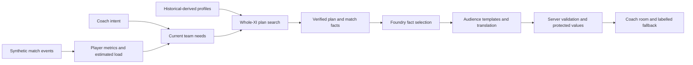

# Live Substitution Intelligence

**The next bench decision, with the whole team in view.**

Live Sub Intel connects what is happening in a match to the next bench decision. It compares substitutions and tactical changes across the current eleven, then explains the selected plan for broadcasters, analysts and coaches in ten languages.

[Watch the 1:45 demo video](https://www.youtube.com/watch?v=pkH76wz9Qq4) · [Try the Azure demo](https://live-sub-intel-fcfudheze9b5ewfz.swedencentral-01.azurewebsites.net/?team=1&minute=65&stance=attack&objective=win&inspect=1) · [One-minute judge guide](docs/submission/JUDGE_GUIDE.md) · [Submission description](docs/submission/SUBMISSION.md) · [Hackathon fit and evidence](docs/submission/JUDGING_FIT.md)

Built by Thomas, Tal and Ofir for the Microsoft × Premier League hackathon.


*Actual Azure interface. Match events are synthetic; player profiles use historical attributes and generated physical estimates. Pitch locations are schematic.*

## What makes the decision useful

- **A fair comparison for the bench.** Each eligible substitution is compared with the best tactical use of the players already on the pitch. Freshness, role suitability, positional movements and tactical costs contribute to the result.
- **Coach intent changes the context.** Choose an attacking, balanced or defensive approach and a result objective. The system recalculates needs and candidate plans.
- **The entire proposed XI is visible.** Inspect the incoming player, named movements, formation, score and alternatives on the pitch. Separate benefit and quality checks govern recommendations.
- **One plan reaches different audiences.** A broadcaster gets a concise football explanation; an analyst gets relevant match statistics and trade-offs; a coach gets game context and role changes.
- **Language is independent of the interface.** Ten explanation locales share the same server-verified plan. English/Hebrew interface controls remain separate from output language.

## See it in one minute

1. **Arsenal, 65, attack / win:** inspect Campbell → Oxlade-Chamberlain. Open the player comparison, then select another alternative; the pitch and explanation follow the selected plan.
2. **Stay on that plan:** request Broadcaster, switch explanation output to Spanish, then select Analyst. Compare the presentation of the same football decision.
3. **Arsenal, 85:** compare Seek a win with Avoid defeat. Observe how the changed objective affects the proposed action.

The replay advances at five-minute checkpoints; Instant is the default. Scripted manager substitutions update the active XI and available bench. Plan inspection is a comparison view; the replay continues along its authored event timeline. [Recording table](docs/submission/RECORDING_ROUTE_HE.md).

## How the intelligence works



The deterministic engine evaluates eligible one-for-one swaps across six supported formations and feasible position assignments. Microsoft Foundry selects optional verified facts and translates protected templates. The server owns plan identity, decision status and literal values; validation and labelled fallback handle rejected or unavailable model output. [Architecture](docs/submission/architecture.svg) · [Event-to-decision walkthrough](docs/EVENT_PIPELINE.md).

## Working Microsoft integration and evidence

| Evidence | Result |
|---|---|
| Azure App Service + Microsoft Foundry | Public working app with server-side model credentials; GitHub Actions tests and deploys main using OIDC |
| Accepted deployed build | `6056cb4` (PR #36); [live acceptance run](https://github.com/TomThomasPrintac/live-sub-intel/actions/runs/40352309569) |
| Real model requests in that run | **46/46**, all eight translated locales, no English fallback or recorded plan-identity failures |
| Regression verification | **292 Python passed, one optional check skipped; 16 Node passed** |
| Checkpoint/context coverage | **228 local evaluations** across two teams, 19 checkpoints and six coach contexts |

[Original live report](docs/research/live_acceptance_6056cb4_20261026.json) · [Current release and delivery status](docs/submission/FINAL_STATUS.md) · [Full checkpoint review](docs/submission/RECORDING_CHECKPOINT_REVIEW.md).

## Run and verify

Python 3.12 recommended:

```bash
python -m venv .venv
# Activate .venv, then:
pip install -e ".[dev,llm]"
python scripts/serve_app.py --port 8779
```

Open `http://127.0.0.1:8779/?team=1&minute=65&stance=attack&objective=win&inspect=1`.

Default: synthetic data, lively scenario. Historical research mode is separately selectable. Without provider settings, the same decision engine runs locally with labelled template explanations. For Foundry, configure `FOUNDRY_ENDPOINT`, `FOUNDRY_API_KEY` and `FOUNDRY_DEPLOYMENT` server-side.

```bash
python -m pytest -q
node --test tests/test_coach_room_ui.cjs tests/test_match_replay_ui.cjs tests/test_integrated_ui.cjs
python scripts/audit_submission_package.py
```

The manual **Live acceptance on Azure** workflow makes bounded real model requests and records the deployed SHA. Run it after deployment; each report applies to its recorded build.

## Methodology and sources

The demo combines an authored synthetic match with profiles computed from historical base attributes and season evidence, supplemented by generated physical estimates. StatsBomb Open Data supports the historical research; SkillCorner positional references inform physical estimates. [Source versions, attribution and conditions](docs/submission/DATA_SOURCES.md) · [Third-party notices](THIRD_PARTY_NOTICES.md).

The prototype evaluates one substitution at a time. Load, role fit and utility are estimates; scores are not win probabilities. Technical test results and translation checks are separate from coaching-outcome validation and native-speaker fluency. [Methodology](docs/METHODOLOGY.md) · [Decision review](docs/submission/DECISION_REVIEW_20261024.md).


Historical research uses StatsBomb Open Data. [Logo provenance](docs/submission/STATSBOMB_LOGO.md).

[Documentation index](docs/README.md) · [Submission checklist](docs/submission/SUBMISSION_CHECKLIST.md) · [English video script](docs/submission/VIDEO_SCRIPT.md)
