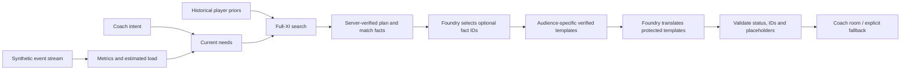

# Live Substitution Intelligence

**From match events to an explainable bench decision.** Compare a substitution with the best tactical adjustment available to the current eleven, then explain the inspected plan for a broadcaster, analyst or coach.

[Open the live Azure demo](https://live-sub-intel-fcfudheze9b5ewfz.swedencentral-01.azurewebsites.net/?team=1&minute=65&stance=attack&objective=win&inspect=1) · [60-second judge guide](docs/submission/JUDGE_GUIDE.md) · [Methodology](docs/METHODOLOGY.md) · [Submission description](docs/submission/SUBMISSION.md)

Microsoft × Premier League hackathon project by Thomas, Tal and Ofir. Working deployed baseline checked on 24 October 2026: `95456a7`. Changes in an open PR are not live until merged and deployed.

## Try three different decisions

1. **Arsenal, 65, attack / win:** inspect a proposed substitution and select a different alternative. Each has its own lineup, score, rejection status and explanation.
2. **Arsenal, 85, attack / win:** the side is behind. Compare repositioning without a substitution against the remaining bench option.
3. **Liverpool, 85, balanced / win:** protecting a lead can produce a defensive substitution and shape change. Switch the approach to see how intent affects the ranking.

The timeline advances under your control every five minutes. Instant is the default; slower playback is optional. Scripted manager substitutions change the active XI and remaining bench. Inspecting an option does not execute it or rewrite subsequent events.

## One intelligence, three experiences

| Audience | Output |
| --- | --- |
| Broadcaster | Two short qualitative sentences, including a material rejection reason or trade-off. |
| Analyst | Match statistics up to the checkpoint, benefit against the threshold and relevant score components. |
| Coach | Score, objective, estimated load, discipline context, positioning and tactical trade-offs. |

The interface is English/Hebrew. Explanation output is separately selectable in English, Hebrew, Arabic, Spanish, French, German, Italian, Portuguese, Japanese and Simplified Chinese. English/Hebrew sentences are authored templates; Foundry translates the other eight with validation and explicit English fallback. This is ten supported locales, not a claim of universal language coverage or native-speaker verification.

## How it works



The deterministic engine owns the decision. All available one-for-one swaps, six supported shapes and feasible position assignments are compared with the best action without a substitute. A quality gate prevents freshness from justifying excessive tactical loss. Scores are model units, not win probabilities. Foundry selects which optional facts to tell; mandatory decision/rejection facts remain server-controlled. Names and numbers are inserted by the server after template translation.

The translation validator caught a real limitation: a valid JSON response can reverse “meets the recommendation criteria.” Recorded Arabic/German/Portuguese failures now have regression tests and locale-specific status checks. These checks reduce that failure mode; they do not prove every sentence fluent or semantically perfect.

## Run locally

Python 3.12 recommended:

```bash
python -m venv .venv
# Activate .venv, then:
pip install -e ".[dev,llm]"
python scripts/serve_app.py --port 8779
```

Open `http://127.0.0.1:8779/?team=1&minute=65&stance=attack&objective=win&inspect=1`.

The default is `--data-mode synthetic --scenario lively`. `--scenario original` retains the old fixed-XI comparison. `--data-mode historical` is a separate research benchmark, not the submission demo. Optional research exports are generated locally and are not bundled as ZIP/Excel assets.

Without credentials the decisions work offline and explanations are labelled templates. For Foundry, set `FOUNDRY_ENDPOINT`, `FOUNDRY_API_KEY` and `FOUNDRY_DEPLOYMENT` server-side; never commit keys. Azure App Service hosts the app, and GitHub Actions tests/deploys main using OIDC.

## Verify

```bash
python -m pytest -q
node --test tests/test_coach_room_ui.cjs tests/test_match_replay_ui.cjs tests/test_integrated_ui.cjs
python scripts/live_acceptance.py https://live-sub-intel-fcfudheze9b5ewfz.swedencentral-01.azurewebsites.net --require-model --extended-audiences
```

The last command makes bounded real model requests. Local tests do not prove Azure connectivity. Health reports build/configuration; fresh acceptance establishes request-time behavior. The live acceptance workflow is available under Actions. See [independent release review](docs/submission/RELEASE_REVIEW_20261024.md) for exact build, results and limitations, and [earlier acceptance evidence](docs/research/LIVE_ACCEPTANCE_20261024.md).

## Scope, sources and limitations

Match actions are original synthetic events with a reproducible seed, not a real fixture or a calibrated match-outcome simulator. Player/squad priors are historical, including FIFA16/StatsBomb evidence. Physical references include SkillCorner. Estimated possession is derived from event-control time; load and pitch positions are estimates. Counts use only past events and rewind with the clock.

One substitution is inspected at a time. No ten-player solver, opposition-specific weakness detector, real-time tracking, validated win-probability model or autonomous multi-agent team is claimed. Technical consistency tests do not establish that a substitution improves results. See [five decision sanity checks](docs/submission/DECISION_REVIEW_20261024.md).

[Data sources and outstanding permissions](docs/submission/DATA_SOURCES.md) · [Third-party notices](THIRD_PARTY_NOTICES.md) · [Final checklist in Hebrew](docs/submission/FINAL_CLOSEOUT_HE.md) · [English video script](docs/submission/VIDEO_SCRIPT.md)

[Calculation walkthrough and sanity checks (Hebrew)](docs/research/CALCULATIONS_SANITY_HE_20261024.md)


Historical research uses StatsBomb Open Data; the displayed match events are synthetic. Physical estimates use SkillCorner positional references. [Official logo provenance](docs/submission/STATSBOMB_LOGO.md).

Publication rights for retained FIFA/StatsBomb-derived inputs are not established merely by citations, old dates or removal of export archives. Those gates remain explicit; this README does not certify them.
