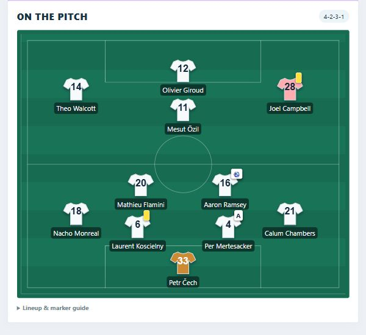
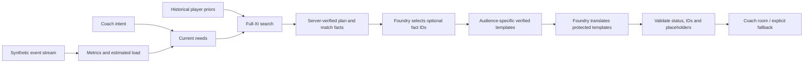

# Live Substitution Intelligence

**From match events to an explainable bench decision.** Compare a substitution with the best tactical adjustment available to the current eleven, then explain the inspected plan for a broadcaster, analyst or coach.

[Open the live Azure demo](https://live-sub-intel-fcfudheze9b5ewfz.swedencentral-01.azurewebsites.net/?team=1&minute=65&stance=attack&objective=win&inspect=1) · [60-second judge guide](docs/submission/JUDGE_GUIDE.md) · [Event-to-decision walkthrough](docs/EVENT_PIPELINE.md) · [Submission description](docs/submission/SUBMISSION.md)

Built for the Microsoft × Premier League hackathon by Thomas, Tal and Ofir. **Deployed acceptance baseline: `0f3e19d` (PR #33), 46/46 model-assisted explanations, all eight translated locales, no English fallback.** [Exact evidence and release status](docs/submission/FINAL_RELEASE_20261025.md). Later branch changes require their own deployment check.



*Actual Azure interface, Arsenal at 65 minutes. The pitch is schematic; match actions are synthetic.*

## Start with Arsenal

1. **Arsenal, 65, attack / win:** inspect a proposed substitution and select a different alternative. Each has its own lineup, score, rejection status and explanation.
2. **Arsenal, 85, attack / win:** the side is behind. Compare repositioning without a substitution against the remaining bench option.
3. **Arsenal, 90, attack / win:** inspect why waiting can be preferred when no plan clears both decision gates. Change coach intent and compare the result.

The recording route stays with Arsenal. Liverpool's perspective remains available in the team selector for additional exploration.

The timeline advances under your control every five minutes. Instant is the default; slower playback is optional. Scripted manager substitutions change the active XI and remaining bench. Inspecting an option does not execute it or rewrite subsequent events.

## One intelligence, three experiences

| Audience | Output |
| --- | --- |
| Broadcaster | A compact qualitative decision, its purpose, cost and key named movements. No numerical scores. |
| Analyst | Relevant past-event statistics, concrete position changes, benefit and cost; numerical utility is available when selected. |
| Coach | Game state and intent, concrete role changes, benefits and costs, with estimated fatigue or discipline context when relevant. |

The interface is English/Hebrew. Explanation output is separately selectable in English, Hebrew, Arabic, Spanish, French, German, Italian, Portuguese, Japanese and Simplified Chinese. English/Hebrew sentences are authored templates; Foundry translates the other eight with validation and explicit English fallback. This is ten supported locales, not a claim of universal language coverage or native-speaker verification.

## How it works



The deterministic engine owns the decision. All available one-for-one swaps, six supported shapes and feasible position assignments are compared with the best action without a substitute. A quality gate prevents freshness from justifying excessive tactical loss. Scores are model units, not win probabilities. Foundry selects which optional facts to tell; mandatory decision/rejection facts remain server-controlled. Names and numbers are inserted by the server after template translation.

The translation validator caught a real limitation: valid JSON can reverse recommendation status. Regression cases now cover those failures. Translation uses fixed grammatical context, protected values and one bounded retry for rejected items. These checks reduce errors; they do not certify native-speaker fluency.

## Run locally

Python 3.12 recommended:

```bash
python -m venv .venv
# Activate .venv, then:
pip install -e ".[dev,llm]"
python scripts/serve_app.py --port 8779
```

Open `http://127.0.0.1:8779/?team=1&minute=65&stance=attack&objective=win&inspect=1`.

The default is `--data-mode synthetic --scenario lively`. `--scenario original` retains the old fixed-XI comparison. `--data-mode historical` is a separate research benchmark, not the submission demo. Optional research exports are generated locally and are not bundled as ZIP/Excel assets.

Without credentials the decisions work offline and explanations are labelled templates. For Foundry, set `FOUNDRY_ENDPOINT`, `FOUNDRY_API_KEY` and `FOUNDRY_DEPLOYMENT` server-side; never commit keys. Azure App Service hosts the app, and GitHub Actions tests/deploys main using OIDC.

## Verify

```bash
python -m pytest -q
node --test tests/test_coach_room_ui.cjs tests/test_match_replay_ui.cjs tests/test_integrated_ui.cjs
python scripts/live_acceptance.py https://live-sub-intel-fcfudheze9b5ewfz.swedencentral-01.azurewebsites.net --require-model --extended-audiences
```

The last command makes bounded real model requests. Local tests do not prove Azure connectivity. Health reports build/configuration; fresh acceptance establishes request-time behavior. The live acceptance workflow is available under Actions. [Latest preserved 46-case report](docs/research/live_acceptance_0f3e19d_20261025.json) · [Release status](docs/submission/FINAL_RELEASE_20261025.md) · [Earlier independent review](docs/submission/RELEASE_REVIEW_20261024.md).

## Scope, sources and limitations

The original match generator produces reproducible football-like events. Player profiles are derived from historical priors and event evidence; physical estimates use SkillCorner positional references. Exact sources, transformations and publication status are in [data provenance](docs/submission/DATA_SOURCES.md). The profile layer is not independently generated from scratch. Estimated possession comes from event-control time; load and pitch positions are estimates. Counts use only past events and rewind with the clock.

One substitution is inspected at a time. No ten-player solver, opposition-specific weakness detector, real-time tracking, validated win-probability model or autonomous multi-agent team is claimed. Technical consistency tests do not establish that a substitution improves results. See [five decision sanity checks](docs/submission/DECISION_REVIEW_20261024.md).

[Data sources and outstanding permissions](docs/submission/DATA_SOURCES.md) · [Third-party notices](THIRD_PARTY_NOTICES.md) · [Final checklist in Hebrew](docs/submission/FINAL_CLOSEOUT_HE.md) · [English video script](docs/submission/VIDEO_SCRIPT.md)

[How incoming events become player performance and team needs](docs/EVENT_PIPELINE.md) · [Calculation walkthrough and sanity checks (Hebrew)](docs/research/CALCULATIONS_SANITY_HE_20261024.md) · [Final submission checklist](docs/submission/SUBMISSION_CHECKLIST.md)


Historical research uses StatsBomb Open Data; the displayed match events are synthetic. Physical estimates use SkillCorner positional references. [Official logo provenance](docs/submission/STATSBOMB_LOGO.md).

Publication permissions for retained third-party inputs and derived profiles remain documented in [data provenance](docs/submission/DATA_SOURCES.md). Citations, historical dates and generated estimates do not by themselves resolve those permissions.
