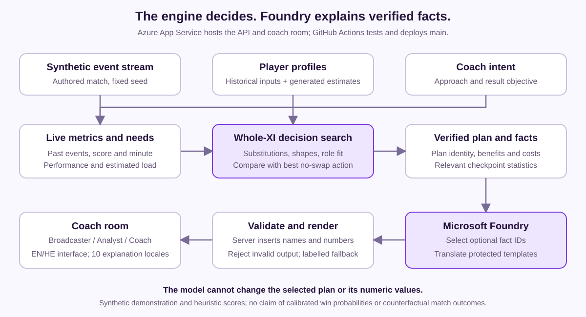

# Live Substitution Intelligence — submission copy

26 October 2026 · Thomas, Tal and Ofir. Prepared English text for the project page. [Current release](FINAL_STATUS.md) · [Judging fit](JUDGING_FIT.md).

## Elevator pitch

Live Sub Intel turns synthetic football events into a clear next move: a substitution, a tactical adjustment or a decision to wait. It compares the whole lineup and explains each plan for broadcasters, analysts and coaches in ten languages, using Microsoft Foundry and Azure App Service.

## Problem and value

A substitution affects the shape and capabilities of the team around the incoming player. Coaching staff need to compare those consequences; analysts and broadcasters need to communicate the reason for the change while the match moves on.

Live Sub Intel connects that decision and its explanation in one workflow. The coach supplies intent, the engine compares feasible plans, and the pitch shows the proposed eleven. The same inspected plan becomes concise commentary, statistical analysis or a coaching explanation in the selected language.

## A concrete example

At minute 65 of the Arsenal demo, the system recommends Oxlade-Chamberlain for Campbell on the right wing. The proposed pitch, player comparison and explanation all refer to that selected plan. The analyst can inspect the freshness benefit and tactical cost, while the broadcaster gets a short football explanation. Switching output to Spanish preserves the inspected plan.

At minute 85, Arsenal is behind. Changing the result objective changes the recommendation. The tool makes that policy choice visible through the current needs, proposed action and score breakdown.

## Distinctive design

1. **Compare the bench with the current eleven's best alternative.** A substitute must add value beyond the best available tactical adjustment without a swap. The search covers eligible one-for-one substitutions, six supported formations and feasible positional assignments.
2. **Keep freshness and quality accountable.** Benefit and tactical-quality checks let a fresh player help while limiting the loss of team capability. Every alternative can be inspected with its own status and proposed lineup.
3. **Connect the explanation to the exact plan.** Microsoft Foundry selects from verified facts about the inspected option. The server preserves identities and literal values and renders audience-specific sentences.
4. **Personalize one intelligence for global viewing.** Broadcaster, Analyst and Coach outputs share the underlying plan. Ten explanation locales are selectable independently of the English/Hebrew interface.

## Working Microsoft implementation

| Component | Role in the deployed app |
|---|---|
| Microsoft Foundry, gpt-4.1-mini deployment | Selects relevant verified fact IDs; translates protected templates into eight additional locales. Server validation and labelled fallback control how responses enter the UI. |
| Azure App Service, Python 3.12 | Hosts the coach room, event replay and evaluation/explanation APIs. Model credentials are server-side. |
| GitHub Actions and Azure OIDC | Run Python/Node regression checks, deploy main, record the build SHA and support a separate live acceptance workflow. |



The workflow is a deterministic planner connected to model-assisted fact selection and translation. Audience modes are output experiences within that workflow. Translation checks protect placeholders and recommendation status; the methodology records the remaining semantic and fluency limits.

## Data creation and research

The displayed match is generated by our seeded possession/event simulator. Its lively scenario contains **1,593 statistical events and 505 visible feed events** in the audited generator version, including authored manager substitutions that change the available XI and bench.

We computed **72 player profiles** from historical base attributes and pre-cutoff season evidence, and supplemented them with generated physical estimates informed by SkillCorner positional references. StatsBomb Open Data supported the historical research and analytical methodology. The extension connects these layers through a shared schema used by the metrics, search, visualization and explanation facts. [Exact sources and transformations](DATA_SOURCES.md) · [Event pipeline](../EVENT_PIPELINE.md).

The match is an authored scenario; player profiles, physical load and positional fit are estimates. The replay does not simulate a causal outcome for an inspected alternative. Historical research mode is available separately from the synthetic submission demo.

## Verification

- **292 Python passed, one optional historical-cache check skipped; 16 Node passed.** Coverage includes event boundaries, rewind, valid lineups, scoring gates, audience/language behavior and server/browser statistics parity.
- **228 local checkpoint/context evaluations** cover two teams, 19 time checkpoints and six combinations of approach/objective. This is model-logic coverage, separate from live provider testing.
- **46/46 model-assisted explanations on Azure build 6056cb4**, translation in all eight additional locales, no English fallback, no recorded identity failures and no digits in broadcaster output. [Accepted run](https://github.com/TomThomasPrintac/live-sub-intel/actions/runs/40352309569) · [Original report](../research/live_acceptance_6056cb4_20261026.json).

These results support the technical behavior shown in the demo. Coaching utility, model scores and translation fluency are evaluated separately; [methodology](../METHODOLOGY.md) and [decision sanity review](DECISION_REVIEW_20261024.md) describe the prototype's scope.

## Testing instructions for judges

The [Azure demo](https://live-sub-intel-fcfudheze9b5ewfz.swedencentral-01.azurewebsites.net/?team=1&minute=65&stance=attack&objective=win&inspect=1) is public and needs no login. Allow time for the initial server startup.

1. Start at Arsenal 65, More attacking / Seek a win. Inspect Campbell → Oxlade-Chamberlain and open the player comparison.
2. Request a Broadcaster explanation, select Spanish, then compare the Analyst output. Keep the same plan selected.
3. Select another alternative and verify that its lineup and explanation update together.
4. At Arsenal 85, compare Seek a win and Avoid defeat. Inspect the changed recommendation and its supporting needs.

[One-minute judge guide](JUDGE_GUIDE.md) · [Full capture table](RECORDING_ROUTE_HE.md).

To run locally with Python 3.12:

```bash
git clone https://github.com/TomThomasPrintac/live-sub-intel.git
cd live-sub-intel
python -m venv .venv
# Activate .venv, then:
pip install -e ".[dev,llm]"
python scripts/serve_app.py --port 8779
```

Set FOUNDRY_ENDPOINT, FOUNDRY_API_KEY and FOUNDRY_DEPLOYMENT server-side for model calls. Without settings, the decisions remain available with labelled templates. `/healthz` reports the build/configuration without exposing keys.


Historical research uses StatsBomb Open Data. Physical references use SkillCorner Open Data, with its MIT notice retained. [Source conditions and attribution](DATA_SOURCES.md).

Delivery: recorded footage is being edited. Add the final public video URL and complete the team fields and entry declarations using the [submission checklist](SUBMISSION_CHECKLIST.md).
